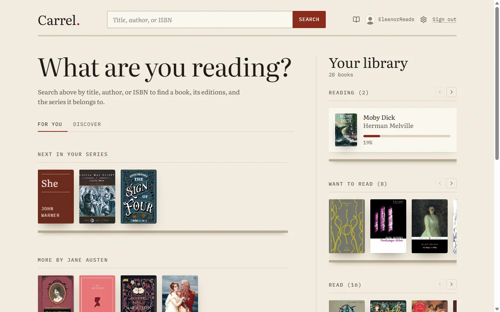
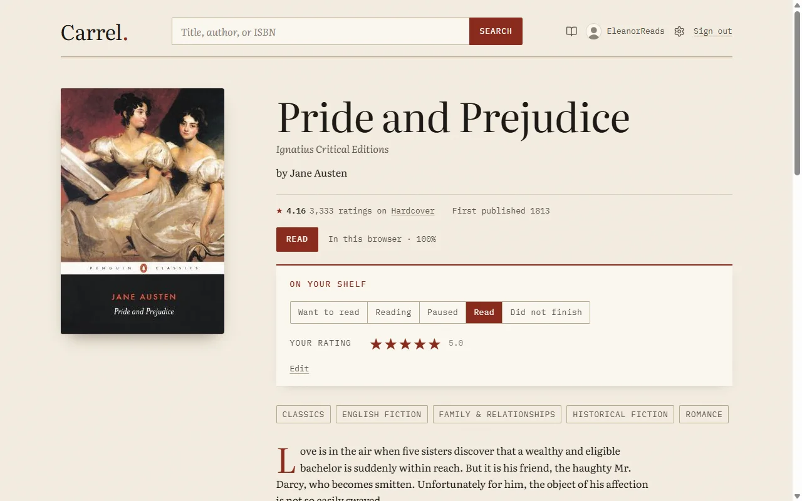
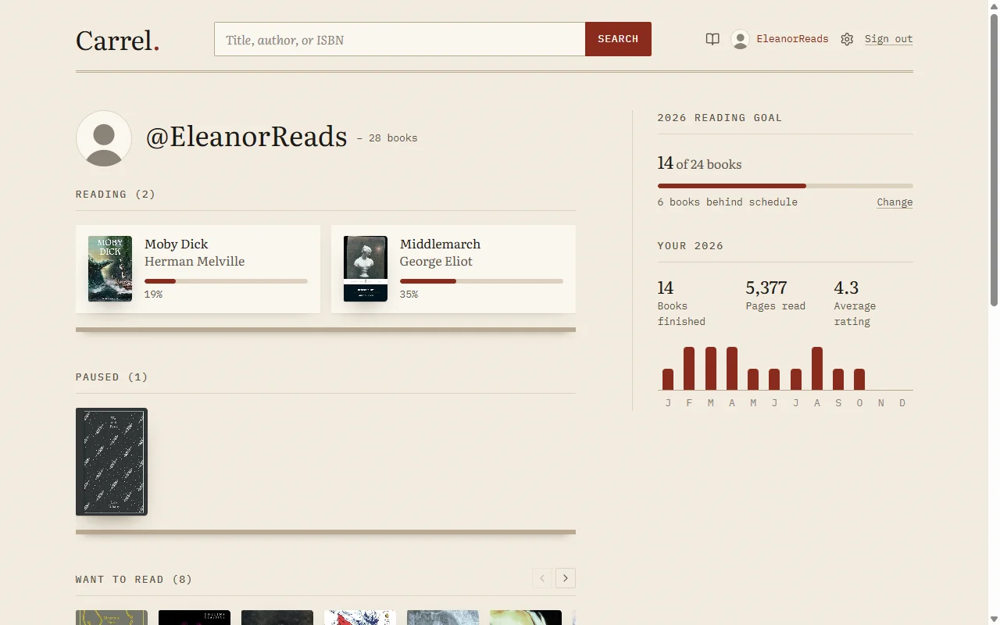
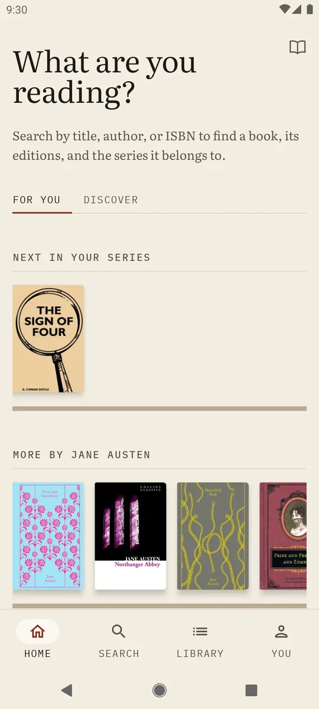
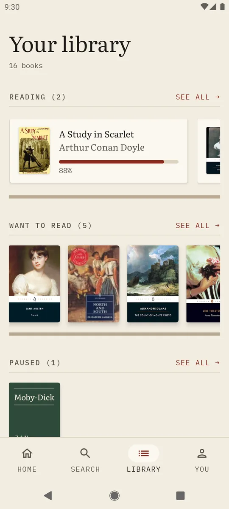
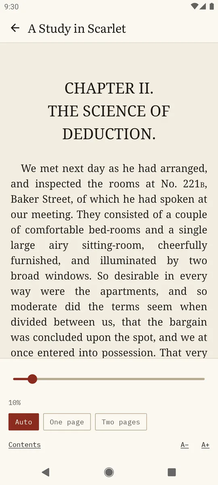

# Carrel

A book-tracking website and Android app: track what you read and find new books.

- Website: https://carrel.zenithal.co.uk
- Android app: https://carrel.zenithal.co.uk/android, or [download the latest APK](https://github.com/Apexcery/Carrel/releases/latest/download/carrel.apk) (Android 8.0 or later)

<picture>
  <source media="(prefers-color-scheme: dark)" srcset="docs/images/web-home-dark.webp">
  
</picture>

## What it does

- **Find books.** Search the catalogue, which comes from Hardcover and Open Library, and browse books' pages, editions, series, and genres.
- **Keep a library.** Shelve books as Want to read, Reading, Paused, Read, or Did not finish, rate them in half stars, log your progress, and record when you started and finished each read.
- **Get suggestions.** The home page suggests books from what you've read, and lets you browse by genre.
- **Share your profile.** Your profile at `/@username` shows your picture, your shelves, and your reading goal for the year. It's public unless you make it private.
- **Bring your library with you.** Import from Goodreads, StoryGraph, or Carrel. Export from Settings → Import & Export in two formats: Goodreads' columns (which Goodreads, StoryGraph, and Carrel can import; it loses start dates, earlier reads, half stars, and progress) and Carrel's own, which keeps everything and is matched by Hardcover id when imported back.
- **Read your own books.** The eReader, on the website and in the app, opens DRM-free EPUBs from your device or from an OPDS catalogue such as a Calibre content server. Your place follows you between devices, and you can choose the theme, font, text size, spacing, and margins.
- **Make it yours.** Light or dark theme, and an accent colour.

<picture>
  <source media="(prefers-color-scheme: dark)" srcset="docs/images/web-book-dark.webp">
  
</picture>
<picture>
  <source media="(prefers-color-scheme: dark)" srcset="docs/images/web-profile-dark.webp">
  
</picture>

## Android app

Everything the website does, plus offline changes that sync once you're back online, two pages side by side on tablets and unfolded foldables, links and shares that open in the app, and home-screen shortcuts. It isn't in the Play Store: install the APK once, and the app offers each new version itself. See [the app's page](https://carrel.zenithal.co.uk/android) for how to install it.

  <picture>
    <source media="(prefers-color-scheme: dark)" srcset="web/public/android-screens/home-dark.webp">
    
  </picture>
  <picture>
    <source media="(prefers-color-scheme: dark)" srcset="web/public/android-screens/library-dark.webp">
    
  </picture>
  <picture>
    <source media="(prefers-color-scheme: dark)" srcset="web/public/android-screens/reader-dark.webp">
    
  </picture>

## Working on Carrel

- [Development](docs/development.md): setting up, running locally, building the Android app, and database migrations.
- [Operations](docs/operations.md): the import queue, auth emails, and copyright takedowns.
